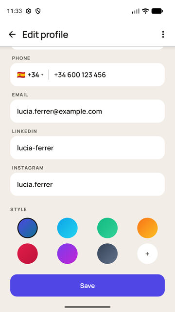
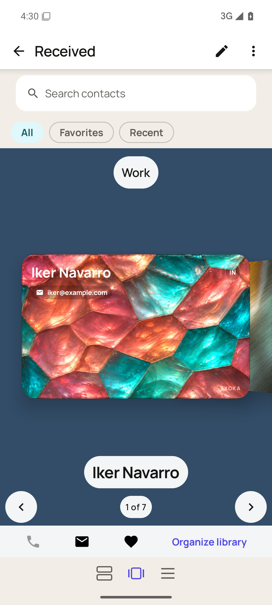
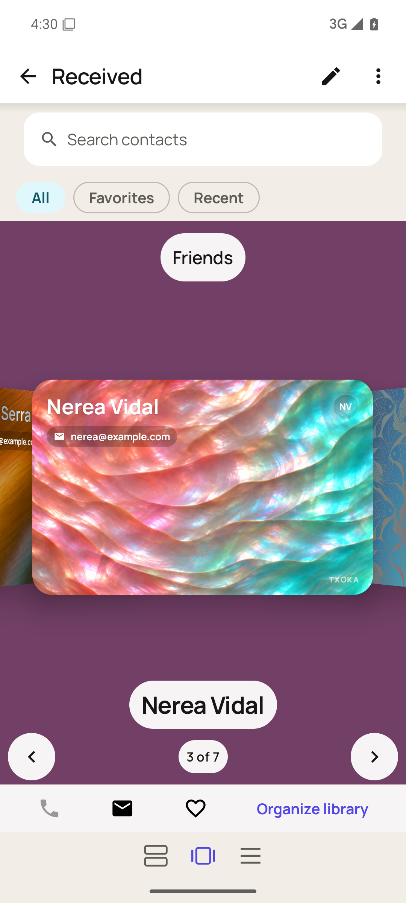
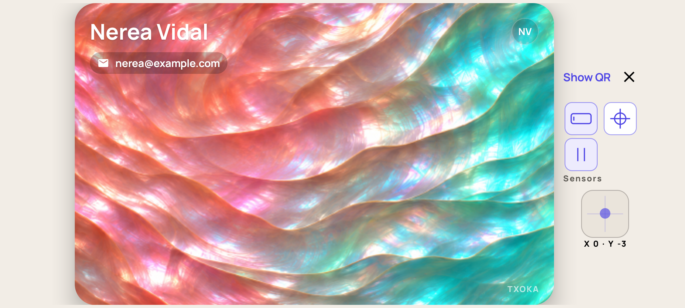

<p align="center">
  
</p>

<h1 align="center">Txoka</h1>

<p align="center">Your contact card, phone to phone. No account, no internet permission.</p>

<p align="center">
  
  <a href="LICENSE"></a>
  
  
</p>

<p align="center">
  
  
  
  
</p>

Share a contact card by holding two NFC phones together or showing its QR code. The other person
decides whether to keep it; over NFC, they can send theirs back on a second tap. Sharing is direct:
there is no backend, no account and no `INTERNET` permission.

## What it does

- **Your card.** Name, phone, email, LinkedIn and Instagram. Choose a gradient, holographic,
  stained-glass, nacre, brushed-metal or flat background; a local vector mosaic; and a water,
  earth, wind or fire effect. Name and contact data have independent lettering finishes, four size
  presets and colours. The three material backgrounds use bundled textures edited from the
  approved reference, with palette and lighting adjustments on the device. Older cards keep their
  original gradient and automatic text contrast.
- **Share.** The phone emulates an NFC Forum Type 4 Tag carrying a vCard 3.0 record. **Send**
  advertises the card, **Receive** listens. Double-tap a card, or use **Show QR**, to flip it over
  and show a QR code on the same chosen background. Double-tap again or use the button to return.
- **QR fallback.** Scan with the optional camera or import an image through the system file
  picker. Txoka restores the contact and its supported style; another phone's camera may offer to
  import the basic contact without the style. Scanning works offline. Camera permission is asked
  only after **Use camera**; image import needs neither camera nor storage permission.
- **Receive.** Nothing is stored until you accept it. Cards that arrive while the sheet is open wait
  in a queue instead of overwriting each other, and a card you already have is updated rather than
  duplicated.
- **Keep.** Browse received cards in Cover Flow, category shelves or a searchable list. Cover Flow
  keeps the active card facing forward and angles its neighbours; its background follows the active
  category and blends while swiping between categories. Open a card full screen, or use its date,
  private note, call/email actions and *Add to contacts* without asking for `WRITE_CONTACTS`.
- **Organise.** Create categories with a name, icon and flat or two-colour gradient background;
  reorder categories and cards, move cards between categories and mark favourites. This organisation
  is private device metadata, stored separately from the received contacts and never shared by NFC or QR.
- **Local and private.** No ads, no analytics, no crash reporting and no network access. NFC and QR
  share the contact fields and appearance you choose; private notes and library organisation are
  excluded. Links to a profile open in the browser: the app never fetches them.

## Requirements

Android 8.0 (API 26) or newer. NFC exchange needs two phones with NFC. QR provides another way to
share: display the code for another phone to scan, or import a QR image in Txoka. NFC and camera
hardware are optional; the card editor, library and image import work without them.

## Build and run

```sh
export JAVA_HOME="/Applications/Android Studio.app/Contents/jbr/Contents/Home"

./gradlew :app:assembleDebug
./gradlew :app:testDebugUnitTest detekt ktlintCheck
./gradlew :app:installDebug
```

Release signing, coverage, instrumented tests and the NFC device plan are in
[`TESTING.md`](TESTING.md). How the app is put together, what travels over the tag and why it looks
the way it does are in [`ARCHITECTURE.md`](ARCHITECTURE.md).

The native implementation and compact wire format are documented in
[`CARD_APPEARANCE.md`](CARD_APPEARANCE.md).

The full-screen viewer keeps the card's ISO ID-1 proportions. In landscape it uses the available
height in an immersive window, with movement, QR and close controls in a side rail.

## Appearance review

The [native library and landscape gallery](store/screenshots/library/README.md) shows the card
materials, Cover Flow category backgrounds, shelves, organizer and immersive viewer in **22 raw
Android screenshots** with fictional contact details. The older
[editor gallery](store/screenshots/review/README.md) and
[materials/QR gallery](store/screenshots/materials-qr/README.md) remain separate historical evidence.

The latest revision passes **334 JVM tests** and **20 API 35 Android cases**: 19 permanent tests
plus the capture flow. Debug/release build, lint, the 95% coverage gate and static checks pass.
Five independently decoded QR screens retain the correct own-card or received-card payload.
The demo's 216 Node cases and additional Chromium checks are recorded separately in
[`TESTING.md`](TESTING.md); physical NFC, sensors and Brave still require device checks.

<p align="center">
  <a href="store/screenshots/library/12-library-coverflow-work.png"></a>
  <a href="store/screenshots/library/13-library-coverflow-friends.png"></a>
</p>
<p align="center">
  <a href="store/screenshots/library/15-library-viewer-landscape-front.png"></a>
</p>

## Known limitations

- The hub role decides the NFC mode, so one tap carries one card and the phone that listens cannot
  also advertise. Which phone ends up as the card is still up to the controllers.
- HCE answers only while the screen is on, and a locked phone with *Require device unlock* on
  answers `6985` instead.
- The NDEF AID `D2760000850101` is shared with every NDEF HCE app, so another app can claim the tag.
- Reading an emulated card needs an app that handles `NDEF_DISCOVERED` for `text/vcard`; without
  Txoka installed the phone will not offer to save the contact on its own.
- Phone numbers typed without a prefix use the country picked in the editor, which defaults to the
  SIM region, then the network, then the device locale and finally Spain.
- No sync or vCard-file/library export: notes are plain text, one per contact, and stay private.
- The NFC message is limited to 768 bytes, including its record framing and Android Application
  Record. A larger card can be saved for QR sharing if its UTF-8 vCard fits the separate 2,048-byte
  QR limit; the editor warns that NFC is unavailable for that card.
- Large QR codes need enough screen space and a clear view. Physical camera interoperability
  still needs device checks; other scanners may ignore Txoka's appearance extension.
- Appearance and NFC interoperability need validation on physical phones. A sensorless device can
  display designs and use manual movement controls. User-selected text colours may need adjustment
  for contrast.

## How it was built

Txoka was built with an AI coding agent (DeepSeek V4.1 Flash 1017,
`deepseek/deepseek-v4.1-flash-1017` on OpenRouter) following the rules in `AGENTS.md`: one branch
per change, no self-merged pull requests, and build, tests, detekt and ktlint before every commit.
The first working version took 43 pull requests; fixing what the phone tests found brought it to
51.

The emulator has no NFC, so the card exchange was debugged by hand on two phones. The results are
in [`NFC_DEVICE_TEST_PLAN.md`](NFC_DEVICE_TEST_PLAN.md).

## Licence

Txoka is free software under the GNU General Public License v3.0 only (`GPL-3.0-only`). See
[`LICENSE`](LICENSE) for the full text. Third-party components and their licences are listed in
[`THIRD_PARTY_NOTICES.md`](THIRD_PARTY_NOTICES.md); the bundled Manrope font uses the SIL Open
Font License 1.1 (`licenses/Manrope-OFL.txt`). The licence texts also ship inside the APK under
`assets/`.

Release history: [`CHANGELOG.md`](CHANGELOG.md).
