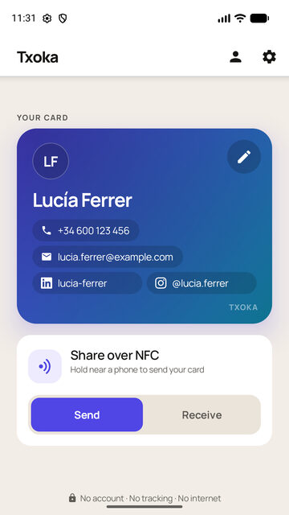
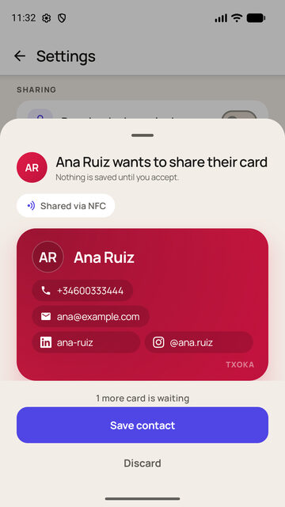
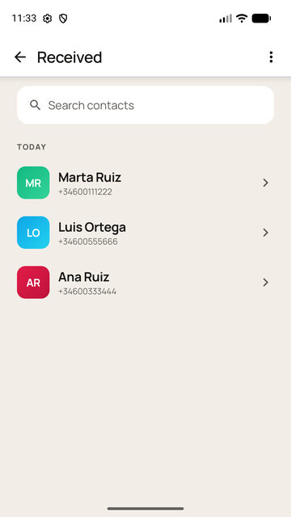

<p align="center">
  
</p>

<h1 align="center">Txoka</h1>

<p align="center">Your contact card, phone to phone. No account, no internet permission.</p>

<p align="center">
  
  <a href="LICENSE"></a>
  
  
</p>

<p align="center">
  
  
  
  
</p>

Share a contact card by holding two phones together. The other phone sees the card, decides whether
to keep it, and can send theirs back on a second tap. Everything stays on the two phones: there is
no backend, no account and no `INTERNET` permission.

## What it does

- **Your card.** Name, phone, email, LinkedIn and Instagram. Choose a gradient, holographic or flat
  background; a local vector mosaic; and a water, earth, wind or fire effect. Name and contact data
  have independent lettering finishes, four size presets and colours. Older cards keep their
  original gradient and automatic text contrast.
- **Share.** The phone emulates an NFC Forum Type 4 Tag carrying a vCard 3.0 record. **Send**
  advertises the card, **Receive** listens.
- **Receive.** Nothing is stored until you accept it. Cards that arrive while the sheet is open wait
  in a queue instead of overwriting each other, and a card you already have is updated rather than
  duplicated.
- **Keep.** A searchable library with the date, a note you can add, call and email actions, and
  *Add to contacts* without asking for `WRITE_CONTACTS`.
- **Nothing leaves the phone.** No ads, no analytics, no crash reporting. Links to a profile open in
  the browser: the app never fetches them.

## Requirements

Two Android phones with NFC, on Android 8.0 (API 26) or newer. One phone is enough to create a card
and keep the ones you receive; exchanging needs two.

## Build and run

```sh
export JAVA_HOME="/Applications/Android Studio.app/Contents/jbr/Contents/Home"

./gradlew :app:assembleDebug
./gradlew :app:testDebugUnitTest detekt ktlintCheck
./gradlew :app:installDebug
```

Release signing, coverage, instrumented tests and the NFC device plan are in
[`TESTING.md`](TESTING.md). How the app is put together, what travels over the tag and why it looks
the way it does are in [`ARCHITECTURE.md`](ARCHITECTURE.md).

The [interactive appearance demo](https://txoka-card-lab.olopopo.chatgpt.site/p/6744e651529f19ab8340aaf8fd7de3ef8db8/)
is a public, unlisted browser design reference, with links to the plan and NFC contract.
The native implementation and compact wire format are documented in
[`CARD_APPEARANCE.md`](CARD_APPEARANCE.md).

## Known limitations

- The hub role decides the NFC mode, so one tap carries one card and the phone that listens cannot
  also advertise. Which phone ends up as the card is still up to the controllers.
- HCE answers only while the screen is on, and a locked phone with *Require device unlock* on
  answers `6985` instead.
- The NDEF AID `D2760000850101` is shared with every NDEF HCE app, so another app can claim the tag.
- Reading an emulated card needs an app that handles `NDEF_DISCOVERED` for `text/vcard`; without
  Txoka installed the phone will not offer to save the contact on its own.
- Phone numbers typed without a prefix use the country picked in the editor, which defaults to the
  SIM region, then the network, then the device locale and finally Spain.
- No sync and no export: notes are plain text, one per contact.
- Sharing as a vCard file or a QR code is not implemented; the card travels over NFC only.
- Appearance and NFC interoperability need validation on physical phones. A sensorless device can
  display designs and use manual movement controls. User-selected text colours may need adjustment
  for contrast.

## How it was built

Txoka was built with an AI coding agent (DeepSeek V4.1 Flash 1017,
`deepseek/deepseek-v4.1-flash-1017` on OpenRouter) following the rules in `AGENTS.md`: one branch
per change, no self-merged pull requests, and build, tests, detekt and ktlint before every commit.
The first working version took 43 pull requests; fixing what the phone tests found brought it to
51.

The emulator has no NFC, so the card exchange was debugged by hand on two phones. The results are
in [`NFC_DEVICE_TEST_PLAN.md`](NFC_DEVICE_TEST_PLAN.md).

## Licence

Txoka is free software under the GNU General Public License v3.0 only (`GPL-3.0-only`). See
[`LICENSE`](LICENSE) for the full text. Third-party components and their licences are listed in
[`THIRD_PARTY_NOTICES.md`](THIRD_PARTY_NOTICES.md); the bundled Manrope font uses the SIL Open
Font License 1.1 (`licenses/Manrope-OFL.txt`). The licence texts also ship inside the APK under
`assets/`.

Release history: [`CHANGELOG.md`](CHANGELOG.md).
