# Visual refresh proposal

Status: implemented in the `feat/visual-refresh` branch. Mockups kept as the design reference.

The app works and is accessible, but the interface still looks like a scaffold: stock Material 3
components, default type, default padding and a lot of empty space. This document diagnoses what
makes it look unfinished, proposes a visual direction, and lists the decisions needed before any
code changes.

| Screen | Current |
| --- | --- |
| Hub | 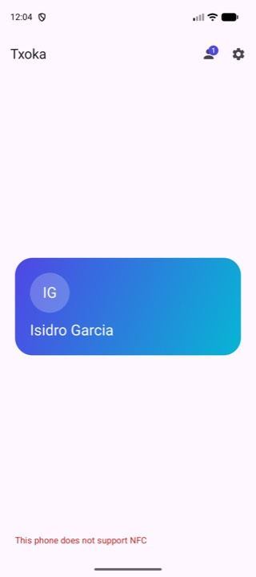 |
| Editor | 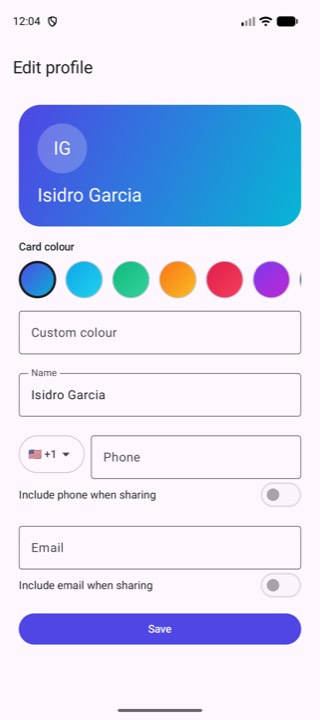 |
| Received list | 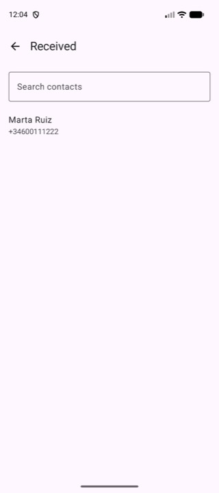 |
| Detail | 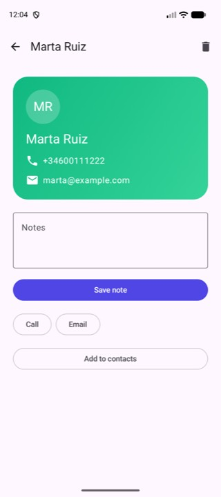 |
| Settings | 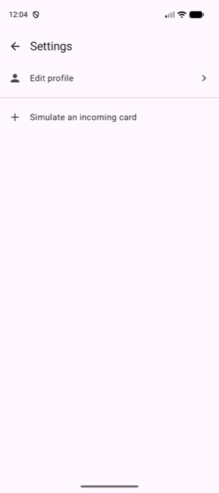 |
| Receive overlay | 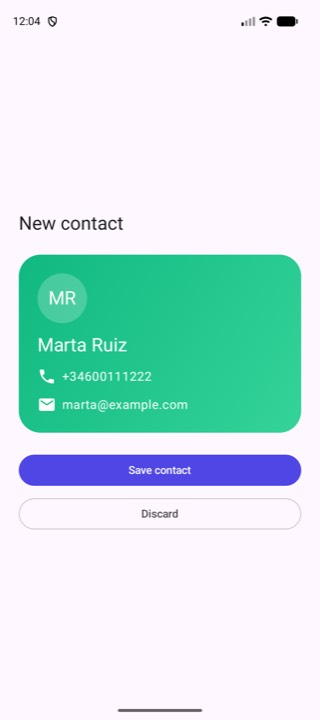 |

## Chosen direction: A, editorial

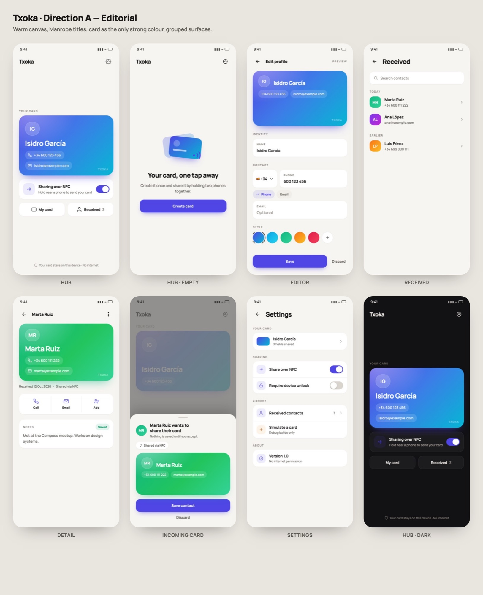

High fidelity HTML mockups of the chosen direction live in `docs/design/mockups/`
(`txoka-mock.html`, rendered with headless Chrome). Individual screens:
[hub](design/mockups/mock-hub.jpg) · [empty](design/mockups/mock-empty.jpg) ·
[editor](design/mockups/mock-editor.jpg) · [received](design/mockups/mock-list.jpg) ·
[detail](design/mockups/mock-detail.jpg) · [incoming](design/mockups/mock-sheet.jpg) ·
[settings](design/mockups/mock-settings.jpg) · [dark](design/mockups/mock-dark.jpg).

Decided:

- Direction **A**: warm canvas `#F7F5F2`, white surfaces, 20–28 dp radii, one strong colour per
  screen, card as the hero.
- Typography: **Manrope** for display and titles, system font for body.
- Sharing switch stays on the hub, in a status module below the card, and also in Settings.
- Brand palette always; no dynamic colour from the wallpaper.
- Received contacts keep the sender's colours (avatar and detail card).

Still open, decided during implementation:

- Whether the hub footer keeps the privacy line ("Your card stays on this device").
- Whether the received list groups by date or stays a flat list with a search field.

## Implemented

Real screenshots after the refresh (Pixel 9 emulator, light and dark):

| Hub | Hub · empty | Editor | Received |
| --- | --- | --- | --- |
| 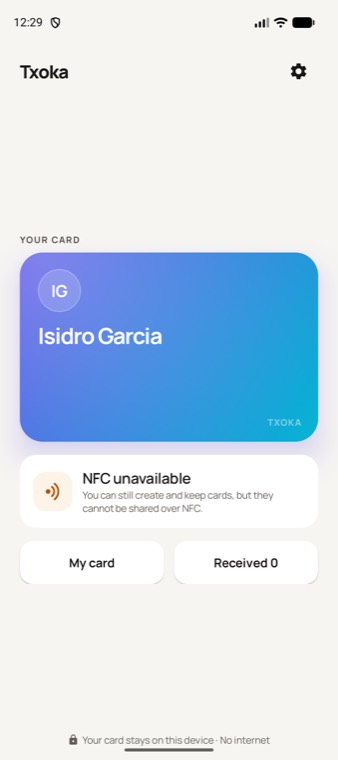 | 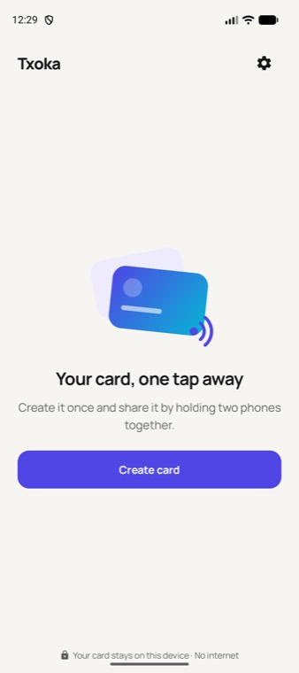 | 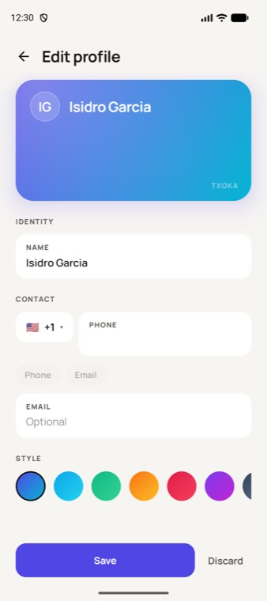 | 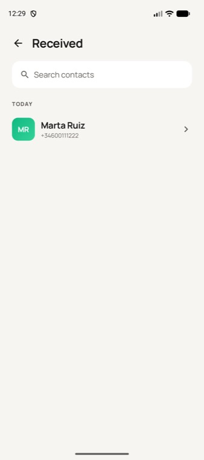 |

| Detail | Incoming | Settings | Dark |
| --- | --- | --- | --- |
| 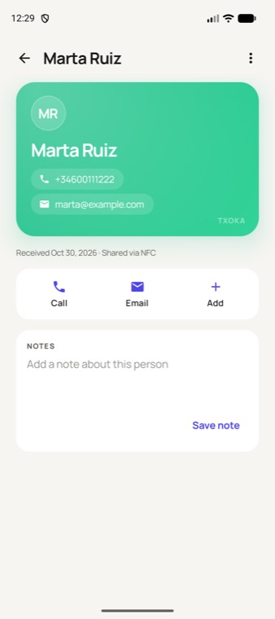 | 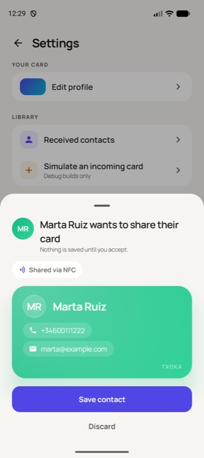 | 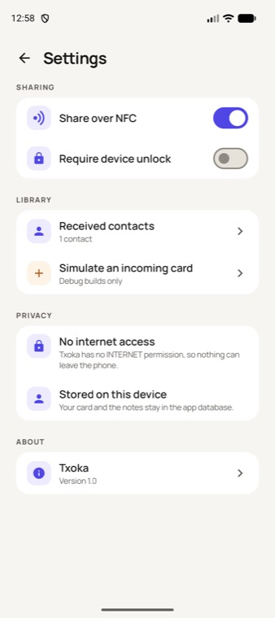 | 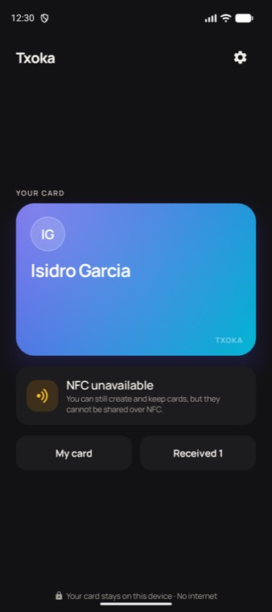 |

| About | Licences |
| --- | --- |
| 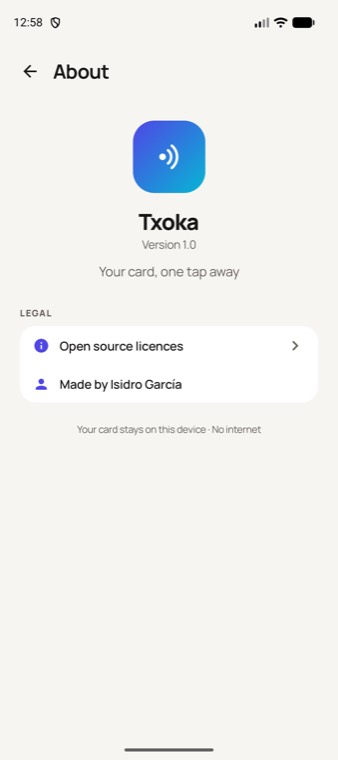 | 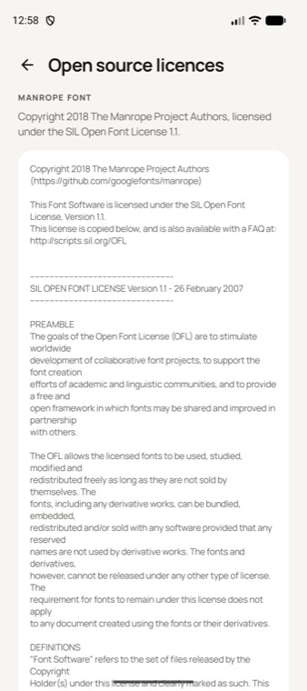 |

## 1. Why it looks unfinished

1. **No design system.** Each screen picks its own paddings (16/24 dp), shapes and sizes. There is
   one shared component (`ContactCard`); everything else is a stock `TopAppBar` + `Column`.
2. **Default typography.** Only `bodyLarge` is customised; names, numbers and labels all render at
   nearly the same weight and size, so there is no hierarchy. Cards use the same style for a name
   and for an email address.
3. **Flat colour.** The brand gradient only appears inside the card and on buttons. Screens are a
   single white/black surface with no tonal layers, so nothing reads as a card, a section or a
   sheet.
4. **Hub has no anchor.** The card floats in the middle of the screen, there is no wordmark, no
   status indicator and no call to action; the only copy is one grey line at the bottom. On a
   device without NFC the screen is a card plus a red sentence.
5. **Settings is a raw list.** Plain rows with dividers, a demo row that looks exactly like a real
   setting, switches without context, and no grouping or section titles.
6. **The card itself is plain.** Gradient + initials + text rows. No depth, no texture, no
   micro-detail that says "this is a product, not a demo".
7. **Received list is unstyled.** Default `ListItem` rows, no avatar, no sender colour, no
   grouping by date, no chevron.
8. **Receive overlay is a full screen.** It appears as a blank page with a title, when it should
   be a modal sheet that keeps the context of the hub underneath.
9. **No feedback or motion.** Saving a note, saving a contact or hitting a duplicate produce no
   confirmation. Navigation is an instant swap; nothing animates.

Accessibility (labels, roles, 200 % font scale, ES/EN) must be preserved and is not part of the
trade-off.

## 2. Three directions

All three keep the indigo → cyan brand gradient as the card identity and work in light and dark.

### A. Editorial (recommended)

Warm neutral canvas, generous white space used deliberately, strong typography, cards as the only
strong colour. Feels like a design-forward contact app (think things/Linear/Arc).

- Background: warm off-white `#F7F5F2` (dark: `#121113`), surfaces `#FFFFFF` / `#1C1B1D`.
- Type: **Manrope** for titles (bundled, OFL) with tight tracking, system Roboto for body.
- Card: 1.58 aspect ratio, 28 dp radius, coloured ambient shadow, soft radial highlight in the
  top-left, name in display size, contact rows as translucent pills.
- Sections: grouped surfaces with 20 dp radius and no dividers.
- Accent usage: one filled button per screen maximum.

### B. Bold gradient

Saturated gradient surfaces, big colour blocks, gradient app bar that fades into the canvas.

- Hub background is a very light gradient tint of the card colours.
- Large gradient CTA pill, gradient ring on the avatar.
- Risk: colour-heavy UI competes with the user's own card colours, and harder to keep contrast.

### C. Minimal Swiss

Pure white/black, hairline borders, no shadows, tiny labels in uppercase, lots of structure.

- Type: Inter, tabular numbers, uppercase 11 sp labels with 1.5 px tracking.
- Cards: flat gradient, 12 dp radius, 1 dp border.
- Very current, but colder and less distinctive; the brand gradient carries most of the identity.

## 3. Design tokens (independent of the direction)

```
Spacing   4 · 8 · 12 · 16 · 24 · 32 · 48
Radius    8 (chips) · 12 (fields) · 20 (sheets/sections) · 28 (cards)
Elevation 0 canvas · 1 sections · 2 sheets · 3 hero card
Type      display 34/40 semibold · headline 28/34 semibold · title 20/26 medium
          body 16/24 regular · label 13/18 medium · caption 12/16 regular
Motion    150 ms press · 220 ms enter · 320 ms shared element, spring damping 0.85
```

Colour roles to add (light / dark): `canvas`, `surface`, `surfaceHigh`, `outlineSoft`, `accent`,
`accentSoft`, `success`, `warning`. The current theme only defines `primary`, `secondary`,
`tertiary`, so every neutral is a Material default.

## 4. Screen by screen

### Hub

```
┌───────────────────────────────────┐
│ Txoka            ◉ Sharing on  ⚙  │   wordmark + status chip
│                                   │
│   ┌───────────────────────────┐   │
│   │  [gradient card, hero]    │   │   8 dp coloured shadow,
│   │  MR  Isidro García        │   │   name at display size
│   │      phone · email        │   │
│   └───────────────────────────┘   │
│                                   │
│   ((( ● )))  Hold near a phone    │   animated NFC waves when on
│   [ Share over NFC        on ]    │   master switch, inline
│                                   │
│   [ My card ]      [ Received 3 ] │   segmented quick actions
└───────────────────────────────────┘
```

- Custom header instead of the default `TopAppBar`: wordmark left, status chip and settings right.
- Card centred but **not** in a 1fr box: it sits in the upper third, with the sharing module
  directly below, so the composition reads as a single block.
- Sharing off: card at 55 % opacity plus "Sharing is off" and a filled "Turn on" button.
- No NFC: card shown normally, the sharing module becomes an explanatory card with an amber
  accent and an action; sharing controls disappear from Settings as they already do.
- Empty state: illustration (card + waves), "Your card, one tap away", body, filled CTA.
- No card header actions (person/settings) duplicated: quick actions live under the card.

### Card

- Hero: 1.58 ratio, 28 dp radius, shadow tinted with `accent`, micro gradient (linear 135° +
  radial highlight), optional subtle noise at 4 % opacity (drawn, not an image).
- Name: display size, max 2 lines, tighter leading; email/phone as 32 dp pills with 12 % white
  fill and leading icons, one per row.
- Small "Txoka" mark bottom-right at 40 % opacity, so a screenshot still identifies the app.
- Compact variant (list rows, settings preview): same gradient, initials, 1-line name, 56 dp.
- Initials avatar: 64 dp, 8 % white fill, 1 dp white 24 % ring.

### Editor

- Collapsing hero: preview shrinks from full card to a 72 dp bar on scroll, keeps the gradient and
  name, so the user always sees what they are editing.
- Sections with titles: **Identity** (name), **Contact** (phone + email), **Style** (palette).
- Phone row: a chip with flag + dial code opens a full-height sheet with search; the field uses
  `KeyboardType.Phone` and shows the formatted number as helper text.
- Sharing switches become two chips under the fields: `Phone` / `Email` with a check mark, since
  they belong to the field, not to a form row.
- Palette: 7 presets as gradient pills with names and a selected ring; "Custom" opens a sheet with
  hex input, live preview and a small set of recent colours.
- Sticky bottom bar with "Save" (full width, filled) and a "Discard" text action; the save button
  shows a spinner while saving and disables on invalid input.

### Settings

Grouped cards with headers, 12 dp inner rows, leading icons in soft accent circles:

```
Your card      [mini card preview]  Edit
Sharing        Share over NFC     [on]
               Require unlock     [off]
Received       3 contacts          →
Developer      Simulate a card     (debug only)
About          Version 1.0 · No internet permission
```

The developer row moves to its own section so it stops looking like a real setting.

### Received list

- Pill search field with a leading icon; filter chips `All` / `This week` (optional).
- Sections by date (`Today`, `This week`, `Earlier`) with 13 sp labels.
- Rows: 44 dp gradient avatar from the sender palette, name (title), phone or email (body),
  chevron; 72 dp height, no dividers inside a section.
- Empty state: illustration, "No cards yet", "Ask someone to share theirs over NFC".

### Detail

- Collapsing hero card (turns into a 64 dp app bar with the name on scroll).
- Action row: three equal icon+label buttons (Call, Email, Add to contacts) in a single surface.
- Notes: card with inline editing, "Saved" confirmation inline, character counter optional.
- Metadata line "Received 12 Oct 2026" under the card.
- Delete moves to an overflow menu with confirmation, freeing the top bar.

### Receive overlay

- `ModalBottomSheet` over the dimmed hub: drag handle, 24 dp radius, content peeks behind.
- Header: avatar + "Marta Ruiz wants to share their card" + provenance chip "Shared via NFC".
- Card preview (hero variant), then "Save contact" filled and "Discard" text.
- Entrance: spring slide-up, card fades in 80 ms later.

### Feedback and motion

- Snackbars: "Contact saved", "Already in your contacts", "Note saved".
- Shared element transition card → detail.
- Haptic tick on toggle and on card tap.
- Splash: gradient background with the logo, then a 200 ms cross-fade into the hub.

## 5. Typography proposal

| Option | Effect | Cost |
| --- | --- | --- |
| System (Roboto) with a real type scale | Neutral, zero APK cost, fastest | Less distinctive |
| Bundle **Manrope** (display + titles) | Distinctive, geometric, reads well at large sizes | ~120 KB per weight, 2–3 weights |
| Bundle **Inter** (all text) | Very readable, familiar in design tools | ~200 KB per weight, or variable font |

Recommendation: Manrope Semibold/Bold for display and titles, system Roboto for body. Only the
Latin subset needs bundling; the typography falls back automatically for other scripts.

## 6. Work plan (if approved)

| Step | Scope | Effort | Risk |
| --- | --- | --- | --- |
| 1 | Tokens, colour scheme (light/dark), shape and type scale, font | S | Low |
| 2 | `ContactCard` redesign (hero, compact, ghost) | M | Low |
| 3 | Hub | M | Low |
| 4 | Editor (sections, sticky bar, sheets) | L | Medium |
| 5 | Received list + detail | M | Low |
| 6 | Settings, receive sheet, snackbars | M | Low |
| 7 | Motion, splash, icon polish, screenshots at 200 % and dark | S | Low |

Each step keeps the current semantics, string keys and tests, and lands with before/after
screenshots in the MR. The Kover gate and the lint checks stay as they are.

## 7. Next step

Approve the mockups and start with step 1 of the work plan: tokens, colour scheme, shapes and
Manrope. Each subsequent step lands with before/after screenshots in its own MR.
