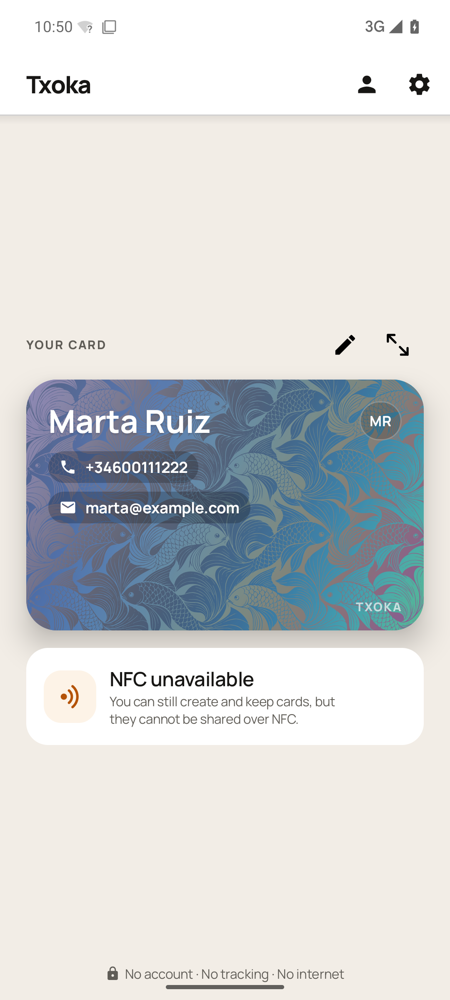
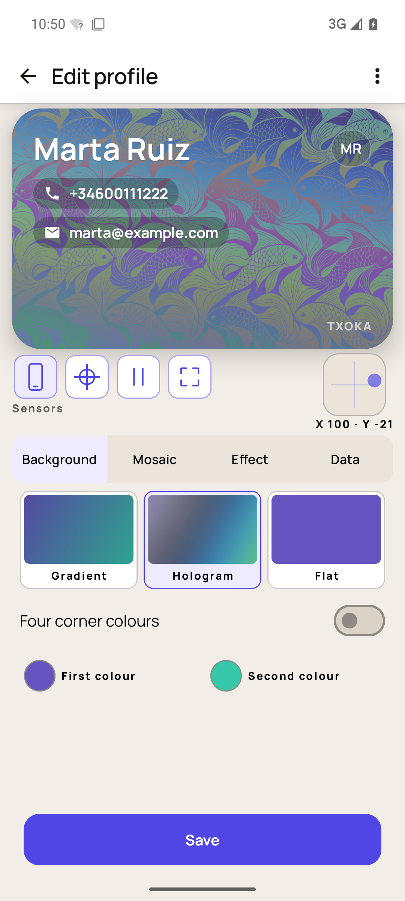
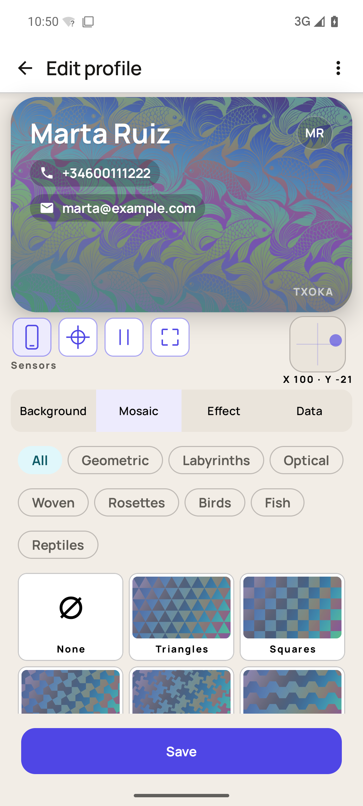
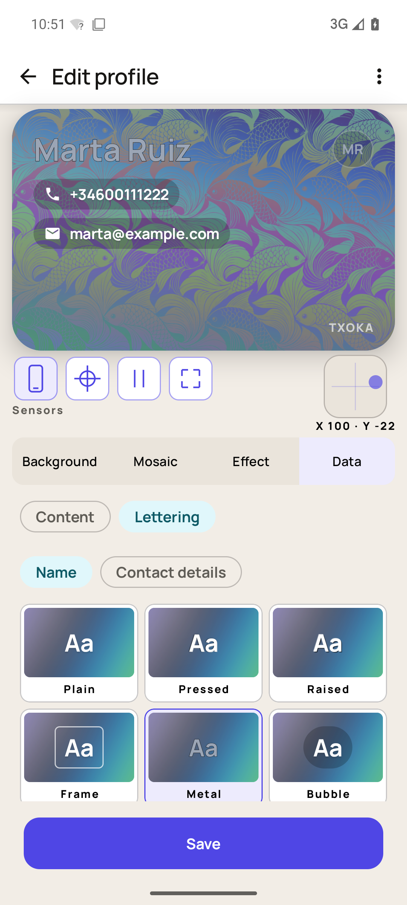
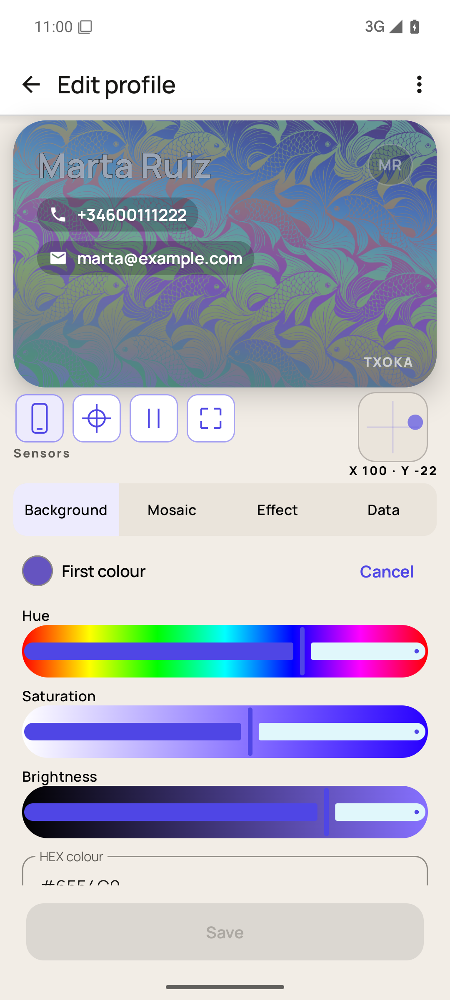
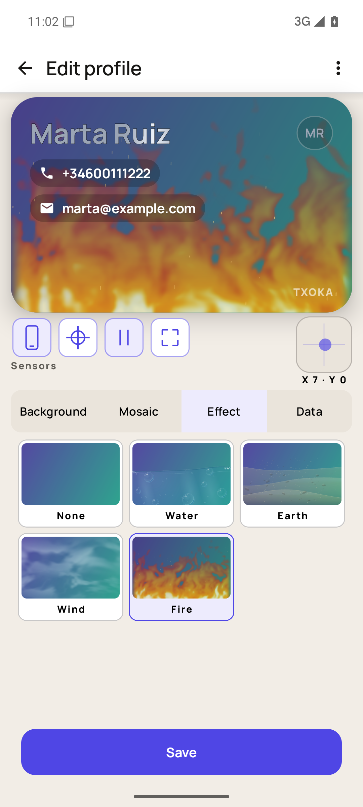
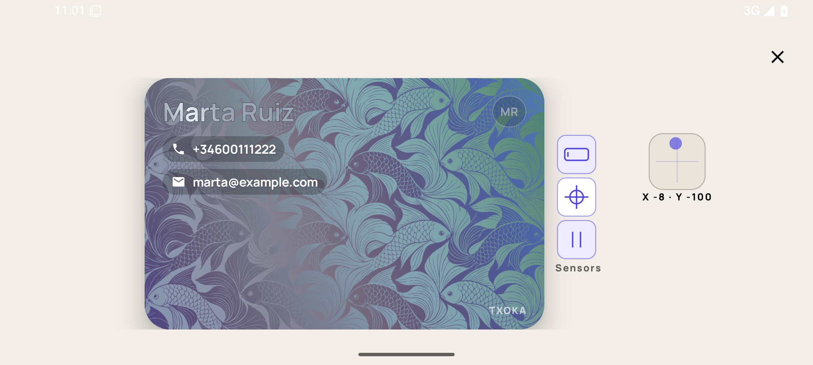

# Native appearance review

These screenshots show the card appearance controls in the existing Android app, including the
hub, pinned editor preview and full-screen landscape viewer. Open an image for the original PNG.

Captured on a Pixel 6 emulator running Android 15 (API 35), at its native 1080 × 2400 resolution
and 420 dpi. The landscape capture is 2400 × 1080. The images are raw device captures, without
compositing or image edits. Marta Ruiz, the phone number and the example.com address are fictitious.
The emulator has no NFC hardware, so its NFC-unavailable message is expected.
The application sources match
[`3d7ce41`](https://github.com/igarciadelamo/txoka/commit/3d7ce41692e3cc064164e026289ed627ef9178da).

## Card and editor

  
  
  

- **Hub:** the personalised card in the existing hub, with the emulator's actual NFC availability.
- **Background:** the card stays visible while its palette and material are changed.
- **Mosaic:** the catalogue shows local designs as coloured previews, grouped by category.

## Lettering, colour and effects

  
  
  

- **Lettering:** separate name and contact targets, with six finishes and metallic glyphs in the preview.
- **Custom colour:** hue, saturation, brightness and HEX controls below the pinned preview.
- **Fire:** an elemental effect selected separately from the background and mosaic.

## Landscape viewer

The full-screen viewer places the card beside its motion controls in landscape. Static captures
show the layout; sensor response and NFC interoperability still require physical-device validation.
